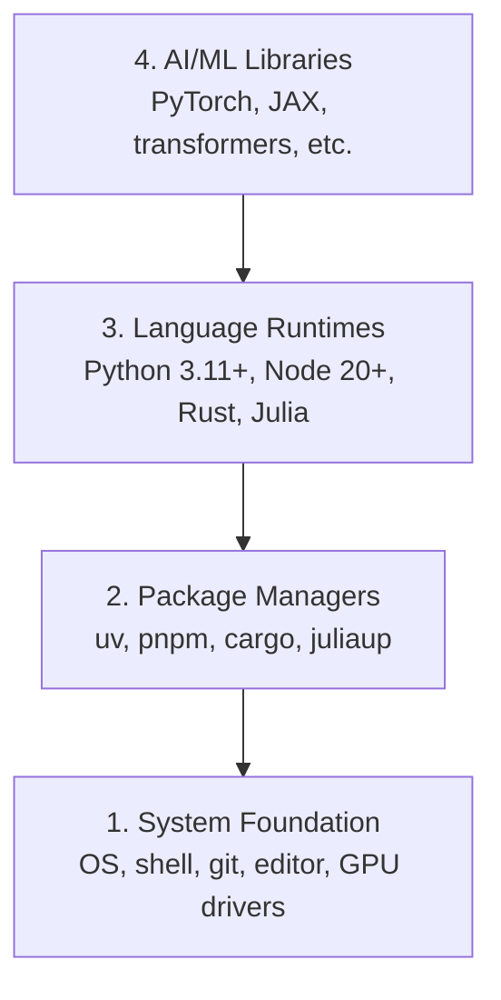

# Pag-set up ng Development Environment

> Hinuhubog ng tools ang paraan mo ng pag-iisip. I-set up ang mga ito nang maayos—isang beses lang.

**Type:** Build
**Languages:** Python, Node.js, Rust
**Prerequisites:** None
**Time:** ~45 minutes

## Mga Layunin sa Pagkatuto

- I-set up mula sa simula ang Python 3.11+, Node.js 20+, at Rust toolchains
- I-configure ang virtual environments at package managers para reproducible ang builds
- I-verify ang access sa GPU gamit ang CUDA/MPS at magpatakbo ng test tensor operation
- Unawain ang apat na layer ng stack: system, packages, runtimes, at AI libraries

## Ang Problema

Mag-aaral ka ng AI engineering sa mahigit 500 lesson gamit ang Python, TypeScript, Rust, at Julia. Kapag sira ang environment mo, bawat lesson ay mauuwi sa pakikipaglaban sa tools imbes na pag-aaral.

Maraming tao ang lumalaktaw sa pag-set up ng environment. Pagkatapos, ilang oras silang nagde-debug ng import errors, version conflicts, at nawawalang CUDA drivers. Aayusin natin ito nang maayos, isang beses lang.

## Ang Konsepto

May apat na layer ang isang AI engineering environment:



Sa pinakailalim tayo magsisimula. Nakadepende ang bawat layer sa layer sa ilalim nito.

```figure
s0-env-stack
```

## Gawin

### Hakbang 1: System Foundation

Suriin ang system mo at i-install ang mga pangunahing kailangan.

```bash
# macOS
xcode-select --install
brew install git curl wget

# Ubuntu/Debian
sudo apt update && sudo apt install -y build-essential git curl wget unzip

# Windows (use WSL2)
wsl --install -d Ubuntu-24.04
```

### Hakbang 2: Python gamit ang uv

Gagamit tayo ng `uv` — 10–100x itong mas mabilis kaysa pip at kusa nitong inaasikaso ang virtual environments.

```bash
curl -LsSf https://astral.sh/uv/install.sh | sh

uv python install 3.12

uv venv
source .venv/bin/activate  # or .venv\Scripts\activate on Windows

uv pip install numpy matplotlib jupyter
```

I-verify:

```python
import sys
print(f"Python {sys.version}")

import numpy as np
print(f"NumPy {np.__version__}")
a = np.array([1, 2, 3])
print(f"Vector: {a}, dot product with itself: {np.dot(a, a)}")
```

### Hakbang 3: Node.js gamit ang pnpm

Para ito sa mga TypeScript lesson (agents, MCP servers, web apps).

```bash
curl -fsSL https://fnm.vercel.app/install | bash
fnm install 22
fnm use 22

npm install -g pnpm

node -e "console.log('Node', process.version)"
```

Tinitingnan muna ng fnm installer kung naka-install ang `unzip`. Kapag wala ito, hihinto ang installer at ipapakita ang `Not installing fnm due to missing dependencies.` Sa Linux, nag-e-extract ito ng zip archive; sa macOS naman, Homebrew ang ginagamit. May `unzip` na ang macOS. Sa Ubuntu, Debian, at WSL2, i-install ito gamit ang Step 1 apt command (`sudo apt install -y unzip`) kung nilaktawan mo ang hakbang na iyon.

**macOS / Apple Silicon (M1/M2/M3/M4):** Kapag huminto ang installer at nagpakita ng `Error: Cannot install under Rosetta 2 in ARM default prefix (/opt/homebrew)`, ibig sabihin tumatakbo ang terminal mo gamit ang Rosetta 2 (`arch` prints `i386`) kahit native arm64 ang Homebrew mo. I-install ang fnm para sa arm64, ikonekta ito sa shell mo, at patakbuhin ulit ang mga command mula sa `fnm install 22`:

```bash
arch -arm64 brew install fnm
echo 'eval "$(fnm env --use-on-cd)"' >> ~/.zshrc
source ~/.zshrc
```

### Hakbang 4: Rust

Para ito sa mga lesson na nangangailangan ng mataas na performance (inference, systems).

```bash
curl --proto '=https' --tlsv1.2 -sSf https://sh.rustup.rs | sh

rustc --version
cargo --version
```

### Hakbang 5: Julia (Optional)

Para ito sa mga lesson na maraming math at bagay gamitan ng Julia.

```bash
curl -fsSL https://install.julialang.org | sh

julia -e 'println("Julia ", VERSION)'
```

### Hakbang 6: GPU Setup (Kung Meron Ka)

**NVIDIA (Linux / Windows):**

```bash
nvidia-smi

# Install PyTorch with CUDA
uv pip install torch torchvision torchaudio --index-url https://download.pytorch.org/whl/cu124
```

**macOS / Apple Silicon (M1/M2/M3/M4):** Walang CUDA sa Mac — normal ito at hindi ibig sabihing may problema. **Huwag** gumamit ng `--index-url .../cuXXX` (para lang sa Linux/Windows ang mga wheel na iyon, kaya mabibigo ang install). I-install ang regular na build, na may Apple MPS (Metal) GPU backend:

```bash
uv pip install torch torchvision torchaudio
```

I-verify (gumagana ito sa anumang platform):

```python
import torch
print(f"CUDA available: {torch.cuda.is_available()}")           # False on macOS — expected
print(f"MPS available:  {torch.backends.mps.is_available()}")   # True on Apple Silicon
if torch.cuda.is_available():
    print(f"GPU: {torch.cuda.get_device_name(0)}")
```

Wala kang GPU? Ayos lang. Gumagana sa CPU ang karamihan ng mga lesson. Para sa mga lesson na mabigat sa training, gumamit ng Google Colab o cloud GPUs.

### Hakbang 7: I-verify ang route na gusto mong simulan

Patakbuhin ang lahat ng command sa lesson na ito mula sa repository root — ang folder na may `README.md` at `phases/`. Ang preflight checks ay para lang sa mga kailangan mo sa napili mong route. Bilang default, nilalaktawan nito ang mga tool na gagamitin pa lang sa susunod para isang malinaw na sagot lang ang makita ng bagong learner, hindi sunod-sunod na babala.

Simulan ang buong beginner sequence:

```bash
python3 phases/00-setup-and-tooling/01-dev-environment/code/verify.py --route beginner
```

O tingnan lang ang route na gusto mo:

```bash
python3 phases/00-setup-and-tooling/01-dev-environment/code/verify.py --route ml-foundations
python3 phases/00-setup-and-tooling/01-dev-environment/code/verify.py --route llm-engineering
python3 phases/00-setup-and-tooling/01-dev-environment/code/verify.py --route agents
python3 phases/00-setup-and-tooling/01-dev-environment/code/verify.py --route mcp
python3 phases/00-setup-and-tooling/01-dev-environment/code/verify.py --route agent-skills
python3 phases/00-setup-and-tooling/01-dev-environment/code/verify.py --route certification
```

Idagdag ang `--show-later` kung gusto mong suriin din ng preflight ang optional tools at dependencies na ginagamit sa mga susunod na lesson. Hindi haharang sa napili mong route ang kawalan ng tool na kailangan pa lang sa bandang huli.

Kasama sa bawat failed na required check ang natukoy na path o import error at ang eksaktong command para ayusin ito. May manual host checks din ang Agent Skills at certification routes dahil hindi kayang patunayan ng Python script kung nakita ng AI host ang skill o kung puwedeng sulatan ang napili mong skill scope.

Kapag pumasa ang beginner preflight, ipapakita nito ang eksaktong unang runnable lesson:

```text
Ready to start Beginner course.
Next: python3 phases/01-math-foundations/01-linear-algebra-intuition/code/vectors.py
```

## Gamitin

Handa na ang environment mo para simulan ang route na sinuri mo. I-install na lang ang susunod na tools kapag kailangan na ng lesson, sa halip na hintaying kumpleto muna ang buong stack bago magsimula. Ito ang mga gagamitin mo sa buong curriculum:

| Wika | Ginagamit sa | Package manager |
|----------|---------|-----------------|
| Python | Phases 1-12 (ML, DL, NLP, Vision, Audio, LLMs) | uv |
| TypeScript | Phases 13-17 (Tools, Agents, Swarms, Infra) | pnpm |
| Rust | Phases 12, 15-17 (Performance-critical systems) | cargo |
| Julia | Phase 1 (Math foundations) | Pkg |

## I-publish

Ang mabubuong artifact sa lesson na ito ay isang verification script na puwedeng patakbuhin ng kahit sino para suriin ang setup nila.

Tingnan ang `outputs/prompt-env-check.md` para sa prompt na makakatulong sa AI assistant na mag-diagnose ng mga problema sa environment.

## Mga Pagsasanay

1. Patakbuhin ang verification script at ayusin ang anumang failed checks
2. Gumawa ng Python virtual environment para sa kursong ito at i-install ang PyTorch
3. Sumulat ng "hello world" sa apat na language at patakbuhin ang bawat isa

### Mga Pahiwatig

**Pagsasanay 1.** Patakbuhin ang `python3 phases/00-setup-and-tooling/01-dev-environment/code/verify.py --route beginner` mula sa repository root at ayusin muna ang unang pumalyang linya bago tingnan ang kasunod. Tapos na ang check kapag pinatakbo mong muli ang script at pumasa na ang bawat required probe.

**Pagsasanay 2.** Gumawa ng environment gamit ang `uv venv` sa repository root, i-activate ito, at i-install ang PyTorch gamit ang Step 6 command na bagay sa hardware mo. Patakbuhin ang `python -c "import torch; print(torch.__version__)"` sa loob ng environment. Kapag may lumabas na version number, gumana ang install.

**Pagsasanay 3.** Gamitin ang apat na runtime mula sa stack sa Ang Konsepto: Python, TypeScript sa Node.js, Rust, at Julia. Gumawa ng isang maliit na file para sa bawat isa at patakbuhin ito gamit ang `python3`, `npx tsx` (hindi kayang patakbuhin ng Node.js nang direkta ang `.ts` file), `cargo run` o `rustc`, at `julia`. Dapat mag-print ang bawat run ng mensahe mo at mag-exit gamit ang code 0.
